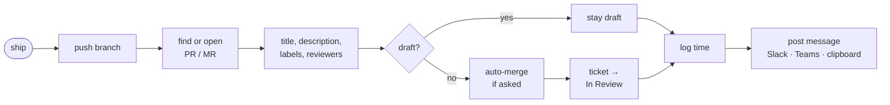

# i-just-want-to-code

**Ship, log, ticket, build: one command each. No Jira tabs needed!**

The busywork around your code (pull requests, ticket status, timesheets, builds, team posts) done by **justcode**, on your stack, with your tools. Claude sets it up for you; every value, step, hook and message is configurable.

`ship` · `tpull` · `tlog` · `tcheck` · `ticket` · `standup` · `release-notes` · `nudge` · `build` · `vpn`

---

## 😮‍💨 Before / after

> **Before:** push, open the code host, create the PR, paste the title, add reviewers, flip auto-merge, open the tracker, move the ticket, open the timesheet, log an hour, copy the link, paste it in the team channel. Seven tabs, four copy-pastes, one forgotten timesheet.

> **After:** `ship -l 9-10 -a`


## ✨ What one `ship` does



Always look first. `-n` does every read and **zero writes**:

```console
$ ship -n -l 9-10 -a
✓ signed in as alice
✓ target main
[dry-run] git push -u origin feature/ABC-123-login
[dry-run] create pull request feature/ABC-123-login -> main: "Add login screen"
[dry-run] set description (only if empty) and labels: mobile
[dry-run] request reviewers: bob
[dry-run] enable auto-merge (squash) when checks pass
[dry-run] move ABC-123: 'In Progress' -> 'In Review'
• time: not logged (no time tracker)
[dry-run] post to slack: <new pull request>
```

One line per step: **✓** done · **•** skipped · **✗** failed. Exit 1 if anything failed, and every command is safe to re-run.

## 🧰 Commands

| | command | what it does |
|---|---|---|
| 🚀 | `ship` | push, PR/MR, reviewers, draft or auto-merge, CI nudge, ticket status, time log, team message |
| ⬇️ | `tpull` | fetch and fast-forward; on divergence recommends rebase or merge and lets you choose |
| ⏱️ | `tlog` | log or move a time entry: `tlog ABC-123 9-10`, `tlog 42 09:30-12:00 yesterday` |
| 📅 | `tcheck` | every day this week (or back `-w N` weeks) against your daily target; `--fill` proposes entries for short days from your commits |
| 🎫 | `ticket` | create tickets from a draft file, fields by their screen names |
| 🗣️ | `standup` | Yesterday / Today / Blockers from your time logs, commits, PRs and in-progress tickets |
| 📝 | `release-notes` | markdown notes between two refs, tickets grouped by type: `release-notes v0.2.0 v0.3.0` |
| 🔔 | `nudge` | one message to the reviewers your PRs have been waiting on; shown first, sent on your yes |
| 📦 | `build` | build a clean worktree, upload, post "build uploaded" |
| 🔐 | `vpn` | `status` · `up` · `down` · `re` · `watch` |
| ⚙️ | `justcode` | `setup` · `config` · `doctor` · `trust` · `edit` · `command` · `run` · … |
| 💬 | `justcode-post` | send any text to clipboard, Slack, Teams or a webhook |

Every command takes `-n` (dry run) and `-h` (help).

## 📥 Install

Two parts: the **plugin** (the skill that teaches Claude justcode) and the **runtime** (the shell commands). Needs `zsh`, `git`, `curl` and `jq`. macOS and Linux (WSL works too).

**1. Plugin, in Claude Code**

```text
/plugin marketplace add yusasarisoy/i-just-want-to-code
/plugin install i-just-want-to-code@i-just-want-to-code
```

**Claude app:** from the plugin directory, once i-just-want-to-code is listed there.

**2. Runtime.** Ask Claude to "set up justcode". It fetches the release that matches the plugin version into `~/.local/share/justcode-src`, checks it against the sha256 pinned in the plugin, shows what `install.sh -n` would do and installs only after you say yes. When the plugin updates, Claude offers the matching runtime update the same way.

Without Claude: clone the repo, read `runtime/install.sh` if you like, then run it (`-n` first shows what it would do):

```bash
git clone https://github.com/yusasarisoy/i-just-want-to-code.git
cd i-just-want-to-code
zsh runtime/install.sh -n
zsh runtime/install.sh
```

It copies the runtime to `~/.local/share/justcode`, links the commands into `~/.local/bin` and asks before overwriting anything. To update: `git pull`, then run it again.

## ⚡ Quick start

Ask Claude:

> set up justcode

If the runtime is not installed yet, Claude first offers to fetch and install it (two yeses, see Install). Then it detects your remote, branch naming and tools, asks at most three rounds of clickable questions, shows the plan and the full config, and writes nothing until you say yes. Then it runs `justcode doctor` and every command with `-n` so you see it work.

### Example prompts

| Ask Claude | What happens |
|---|---|
| "set up justcode for this repo" | Detects your stack, asks up to three rounds of questions, shows the config, writes it on your yes, then runs `justcode doctor` |
| "ship this branch as a draft, reviewer bob, dry run first" | Runs `ship -n` and shows every planned step; runs `ship` only after you approve |
| "log 9-10 today on ABC-123" | Runs `tlog -n ABC-123 9-10`, checks for overlaps, then logs it on your yes |
| "how many hours am I missing this week?" | Runs `tcheck` and lists the days under your daily target |
| "fill my missing hours this week from my commits" | Runs `tcheck --fill -n`, shows each proposed range per ticket, logs them with `tlog` on your yes |
| "write my standup, blocker: waiting for the API keys" | Runs `standup -n -b "..."`, shows the message, sends it on your yes |
| "release notes from v0.2.0 to now" | Runs `release-notes -n v0.2.0`, shows the markdown, writes or sends it on your yes |
| "remind reviewers about my waiting PRs" | Runs `nudge -n`, shows the one message and who it names, sends it on your yes |
| "create the tickets in draft.md as Tasks" | Runs `ticket -n -t Task draft.md`, shows each ticket, creates them on your yes |
| "add a command that opens a deploy preview" | Creates a custom command skeleton with `-n` and `-h`, checks it, and runs it as a dry run |

### Step by step, without Claude

The same onboarding in a terminal, one step at a time. Nothing is written until the step says so.

**1. See the install plan.** `-n` writes nothing; it lists what will be copied and linked, and where.

```bash
zsh runtime/install.sh -n
```

**2. Install.** The runtime goes to `~/.local/share/justcode`, the commands are linked into `~/.local/bin`. A file of yours with the same name is never overwritten without asking. If it prints `• add ~/.local/bin to your PATH`, add that line to `~/.zshrc` (or `~/.bashrc`).

```bash
zsh runtime/install.sh
```

**3. Check the install.** Prints the installed version.

```bash
justcode version
```

**4. Run the setup wizard** inside your repository. It detects the code host from the remote, the ticket key from the branch name (`feature/ABC-123-login` → `ABC`) and your build tools, then asks per section: commands, code host, tracker, time tracker, build, network, messages. Enter keeps the value in brackets, `?` explains a question. Before writing it shows the config as a diff, then runs `justcode doctor`. `justcode setup <section>` re-runs one section later; `-n` shows the diff only.

```bash
justcode setup
```

**5. Store your secrets.** justcode never asks for a token. For each missing one, `justcode doctor` prints the command for your OS; run it, and the OS keychain asks for the value:

```bash
security add-generic-password -a "$USER" -s justcode-code-token -w    # macOS
secret-tool store --label=justcode-code-token service justcode-code-token   # Linux
```

With GitHub you can skip this and reuse the GitHub CLI login: `CODE_TOKEN_SECRET=gh`.

**6. Add your own settings.** Every behaviour is a key in [`references/config.md`](plugin/skills/i-just-want-to-code/references/config.md). For example a time tracker, where standup and nudge messages go, and how long a review may wait:

```bash
justcode edit global
```

```zsh
TIME_PROVIDER=tempo-cloud
TIME_USER=<your account id>
STANDUP_POST_TO=slack
NUDGE_POST_TO=slack
NUDGE_AFTER_HOURS=24
```

**7. Health check.** Checks the tools, every host, that each token belongs to you, and that every secret is stored. Secret values are never shown. Fix every `✗` before going on.

```bash
justcode doctor
```

**8. Read your templates.** `justcode config` shows every effective value and the file it came from, message templates included. Change any template in your config; leave it unset for the default, set it empty to leave that part out (`STANDUP_COMMIT_LINE=''` drops commit lines).

```bash
justcode config | grep -E '^(STANDUP|NUDGE|RELEASE_NOTES)_'
```

**9. First dry runs.** Each one does every read and no write; what it would write shows as a `[dry-run]` line.

```bash
ship -n -l 9-10                              # push, PR, reviewers, ticket move, time log, message
standup -n -b "Waiting for the API keys"     # Yesterday / Today / Blockers from time logs, commits, PRs, tickets
tcheck --fill -n                             # short days of this week, filled from your commits
release-notes -n v0.3.0                      # notes from v0.3.0 to HEAD, grouped by ticket type
nudge -n                                     # one message to reviewers who have waited 24h or more
```

For example, `tcheck --fill -n` lists its proposals and the `tlog` calls it would make. They never overlap an existing entry and never go past your daily target:

```console
✗ Tue 2026-11-17 0m, 8h short
✓ fill: 2 proposals, 3h
  Tue 10:00-12:00 → ABC-123 (4 commits)
  Tue 14:30-15:30 → ABC-123 (1 commits)
[dry-run] tlog -t code ABC-123 10:00-12:00 2026-11-17 Development
[dry-run] tlog -t code ABC-123 14:30-15:30 2026-11-17 Development
```

**10. Run for real** once the dry run looks right: drop `-n`. `tcheck --fill` and `nudge` show what they will do and ask first; `-y` answers yes for you.

## 🛠️ Configure

Three ways, pick one:

1. **Ask Claude** to set up justcode (or to change one thing: "ship should post to Teams").
2. **`justcode setup`** in a terminal: the same questions without Claude. `justcode setup messages` re-runs one section; `--layer team` writes the shared repo file; `-n` shows the diff only.
3. **`justcode edit global|team|local`** opens the file in `$EDITOR`. Every key is in [`references/config.md`](plugin/skills/i-just-want-to-code/references/config.md).

- `justcode config` shows every effective value and which file it came from.
- `justcode trust` reviews and trusts the repo's `.justcode`, `.justcode.local` and team commands.

```text
~/.config/justcode/config      personal, all repos
<repo>/.justcode               team, committed          🔒 needs trust
<repo>/.justcode.local         personal, git-ignored    🔒 needs trust
JUSTCODE_SET='K=v;K2=v'        one run, single values
command flags                 wins
```

## 🎛️ Make it yours

Turn off what you don't use, add what you need:

| you want | set |
|---|---|
| skip ship steps | `SHIP_SKIP=(description reviewers ci ticket time)`, any subset |
| no tracker / no time tracker | `TRACKER_PROVIDER=none` / `TIME_PROVIDER=none` |
| no team message | `SHIP_POST_TO=none` (also `BUILD_POST_TO`, `TICKET_POST_TO`) |
| auto-merge or draft by default | `SHIP_DEFAULT_ARGS=(-a)` or `(-D)`; `-A` turns it off for one run |
| your own step before or after | `SHIP_PRE_HOOK='make lint'`, `SHIP_POST_HOOK='...'` (same for every command) |
| standup that fits your team | `STANDUP_MESSAGE`, `STANDUP_*_LINE`, `STANDUP_DAY=last-workday`, `STANDUP_TODAY_STATUSES=('In Progress' Review)`, `STANDUP_REPOS=(~/src/app ~/src/api)` |
| fill short days your way | `TCHECK_FILL_LEAD_MINUTES`, `TCHECK_FILL_GAP_MINUTES`, `TCHECK_FILL_ROUND_MINUTES`, `TCHECK_FILL_MIN_MINUTES`, `TCHECK_FILL_REPOS`, `TCHECK_FILL_TYPE` |
| your release notes layout | `RELEASE_NOTES_GROUPS=(New 'Story,Feature' Fixed 'Bug' Other '*')`, `RELEASE_NOTES_HEADER`, `RELEASE_NOTES_TICKET_LINE='- [{key}]({url}) {title}'` |
| gentler or stricter nudges | `NUDGE_AFTER_HOURS=48`, `NUDGE_MENTIONS=(bob '<@U123>')`, `NUDGE_REPEAT_HOURS=24` (opt-in quiet period) |
| drop a part of a message | set its template empty, e.g. `STANDUP_COMMIT_LINE=''`; unset means the default |
| where messages go | `STANDUP_POST_TO`, `RELEASE_NOTES_POST_TO`, `NUDGE_POST_TO`: clipboard (default), slack, teams, webhook, none |
| a whole new flow | a custom command (below) |

The core of each command stays on: `ship` always checks the account, pushes and opens or updates the PR, because without them there is nothing to ship.

## 👥 Teams

1. Commit a `.justcode` with the shared settings (target branches, reviewers, status names, message templates). Personal keys such as `CODE_USER` and secret names never go in it; `justcode setup --layer team` moves them to your own file for you.
2. Everyone runs `justcode trust` once, after reading it. When the file changes, it is untrusted again until reviewed.
3. Shared scripts go in `.justcode-commands/`; they are trusted per file in the same way.

## 🛡️ Safety

| | |
|---|---|
| 🧪 **Dry run** | `-n` reads everything and writes nothing; Claude always shows it before the real run and asks again for every run. |
| 🔒 **Trust** | repo files are sourced only when their sha256 is trusted (the direnv model); untrusted files are skipped, never executed. |
| 🔑 **Secrets** | read only from the macOS Keychain or libsecret, passed to curl on stdin, never in argv, logs or output. justcode never asks for a value. |
| 🧱 **Fail closed** | a wrong account, a failed ticket search or an unreachable host stops the command before any write. |
| 🤝 **No surprise merges** | auto-merge is only set when the PR would wait for checks; it never merges by itself. |
| ⏳ **No hangs** | VPN waits are bounded (`NETWORK_WAIT_SECS`). |
| 👤 **You build** | Claude prints `build` commands; you run them. |
| 📦 **Pinned install** | Claude installs only the release tagged with the plugin's version, after a yes to download and a yes to the installer's dry run; it never overwrites a file of yours without asking for that file. |

## 🔌 Supported tools

| layer | built in | via config |
|---|---|---|
| Code host | GitHub (incl. Enterprise) · GitLab (incl. self-hosted) · Bitbucket Cloud | |
| Tracker | Jira Cloud · Jira Data Center · Linear | none |
| Time | Tempo Cloud · Tempo DC · Toggl Track · Clockify | none |
| Build | TestFlight · Google Play | any command (e.g. Firebase App Distribution) · none |
| Messages | clipboard (rich) · Slack · Microsoft Teams · webhook | none |
| VPN | any client with a CLI or an app | presets in [`network.md`](plugin/skills/i-just-want-to-code/references/network.md) |

Not listed? Ask Claude to add a provider, or write one yourself (below).

## 🧩 Custom commands

Need `deploy-preview` or a weekly report? Make it a justcode command:

```console
$ justcode command new deploy-preview     # skeleton with -n, -h, hooks, dry-run guards
$ justcode command check deploy-preview   # static check: no curl, eval or raw secret reads
$ justcode run deploy-preview -n
```

Personal commands live in `~/.config/justcode/commands/`; team commands in `<repo>/.justcode-commands/` and run only after `justcode trust`. Built-in names cannot be shadowed. `justcode doctor` checks them all.

## 🤲 Contributing a provider

1. Read the contract in `plugin/skills/i-just-want-to-code/references/<layer>.md` (code-hosts, trackers, time-tracking, distribution, messages).
2. Add `runtime/providers/<layer>/<tool>.zsh`: only the contract functions plus `<layer>_doctor`; network via `df_http`, secrets via `df_secret`; unsupported → return 3.
3. Add routes to `tests/mock/server.py` and a persona in `tests/personas/`.
4. Run the checks:

```bash
zsh tests/run.zsh
```

```bash
scripts/leakcheck.sh
```

Tests run against a local mock server only: no real APIs, no real secrets.

## ⚠️ Disclaimer

justcode acts on your real accounts: it can push, merge, change tickets, log time, upload builds and post to your team. It comes **as is, with no warranty**; you are responsible for every run you approve, so read the `-n` output first. justcode is not affiliated with or endorsed by GitHub, GitLab, Atlassian, Linear, Tempo, Toggl, Clockify, Apple, Google, Slack, Microsoft or any other vendor; their names and trademarks belong to their owners. Your use of each service follows its own terms and rate limits. Full text: [DISCLAIMER.md](DISCLAIMER.md).

## 📄 License

[MIT](LICENSE)
